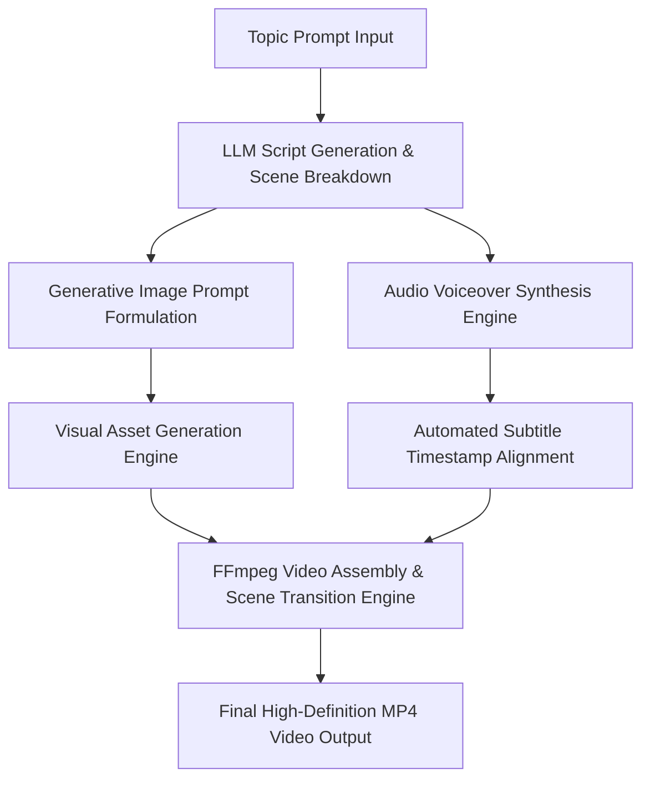

<div align="center">

<h1>Autonomous Video Generation & Media Pipeline</h1>


<p><strong>End-to-End Autonomous Pipeline for Programmatic Media Generation, Voiceover, and Assembly</strong></p>

<p>
  <a href="https://skillicons.dev"></a>
</p>

<p>
  <a href="#overview">Overview</a> &bull;
  <a href="#purpose--problem-statement">Purpose</a> &bull;
  <a href="#real-world-industry-applications">Use Cases</a> &bull;
  <a href="#step-by-step-engineering-walkthrough">How It Was Built</a> &bull;
  <a href="#system-architecture">Architecture</a> &bull;
  <a href="#visual-showcase-gallery">Visual Gallery</a> &bull;
  <a href="#technology-stack-matrix">Tech Stack</a> &bull;
  <a href="#installation--setup">Installation</a> &bull;
  <a href="#author--contact-information">Author</a>
</p>

</div>

---
## Overview

The Autonomous Video Generator is an artificial intelligence application framework engineered for programmatic narrative video production. Given a high-level subject prompt, the system autonomously derives structured scene scripts, formulates generative visual prompts, synthesizes synchronized voiceover tracks, aligns subtitle timestamps, and compiles individual keyframes and audio buffers into high-definition MP4 video deliverables.

---

## Purpose & Problem Statement

### The Problem
Traditional short-form and educational video production is labor-intensive: writing narrative scripts, searching for stock footage, recording voiceovers, manually timing subtitles, and rendering video clips in video editing software takes hours per video clip. For content creators, media agencies, and educational platforms, scaling video production manually is economically unfeasible.

### The Engineering Purpose
To build a fully autonomous, asynchronous media synthesis backend paired with a reactive frontend studio. It coordinates generative LLMs, diffusion image models, audio synthesis engines, and FFmpeg command streams into a unified pipeline producing finished video assets without human editing intervention.

---

## Real-World Industry Applications

- **Automated Social Media News & Digests**: Converting daily RSS headlines into 60-second summary videos for TikTok, YouTube Shorts, and Instagram Reels.
- **E-Learning & Micro-Course Creation**: Programmatically converting written curriculum outlines into engaging multi-scene video lectures.
- **E-Commerce Product Demonstrations**: Generating dynamic promotional videos directly from structured catalog product descriptions.
- **Corporate Training & Employee Onboarding**: Turning standard operating procedures into bite-sized procedural training clips.

---

## Step-by-Step Engineering Walkthrough (How It Was Built)

### Step 1: Topic Prompt Ingestion & Script Decomposition
The user specifies a topic, duration, and target audience tone. The backend script service (`backend/src/modules/script/`) calls an LLM provider to construct a multi-part narrative structure: Hook, Context, Core Value, and Call-to-Action.

### Step 2: Scene Breakdown & Visual Prompt Formulation
The narrative script is decomposed into discrete 4-to-8 second scenes (`backend/src/modules/video-scenes/video-scene.service.ts`). For each scene, an automated visual prompt generator crafts detailed image generation prompts specifying camera angles, lighting temperature, and stylistic consistency parameters.

### Step 3: Multi-Provider Generative Asset Synthesis
The image generation service (`backend/src/modules/images/image-generation.service.ts`) dispatches concurrent image generation requests to generative model providers (Cloudflare AI, Qwen, Wan2.1). Synthesized keyframes are downloaded and cached with unique content hashes.

### Step 4: Synthetic Audio Voiceover & Subtitle Alignment
The audio service (`backend/src/modules/audio/`) interfaces with voice generation providers (ElevenLabs / Edge TTS) to produce natural spoken audio tracks. An automated timestamp extractor tracks word-level durations to generate standardized SRT and ASS subtitle tracks with millimeter typographical alignment.

### Step 5: Programmatic FFmpeg Video Assembly
The assembly engine (`backend/src/modules/video/assembly.service.ts`) invokes FFmpeg worker processes:
- Image keyframes are converted into continuous video streams with smooth zoom-in / pan motion (Ken Burns effect).
- Audio voiceovers and background soundtracks are merged with volume normalization.
- Subtitle streams are burned into the video buffer using custom typography and shadow matrices.
- The composite streams are muxed into an H.264/AAC MP4 output file.

### Step 6: Reactive Review Studio & Iteration UI
A modern Vite + React 18 interface (`frontend/src/`) provides a multi-stage review workspace where creators can inspect script drafts, audition voiceover samples, regenerate individual scene keyframes, and download finalized video files.

---

## System Architecture



---

## Visual Showcase Gallery

<table width="100%" align="center">
  <tr>
    <td width="50%" align="center"><b>Topic Ingestion & Script Studio</b><br><sub>Prompt parameter configuration and structured script generation.</sub></td>
    <td width="50%" align="center"><b>Scene-by-Scene Visual Breakdown</b><br><sub>Granular scene sequencing with prompt customization.</sub></td>
  </tr>
  <tr>
    <td align="center"></td>
    <td align="center"></td>
  </tr>
  <tr>
    <td width="50%" align="center"><b>Audio Synthesis & Voiceover Selection</b><br><sub>Voice parameter tuning with synchronized timestamp alignment.</sub></td>
    <td width="50%" align="center"><b>Final Media Assembly & Video Preview</b><br><sub>Rendered video output with embedded subtitles and transition timing.</sub></td>
  </tr>
  <tr>
    <td align="center"></td>
    <td align="center"></td>
  </tr>
  <tr>
    <td width="50%" align="center"><b>Generative Image Asset Inspector</b><br><sub>Review and regeneration interface for individual video keyframes.</sub></td>
    <td width="50%" align="center"><b>Subtitle Styling & Font Palette</b><br><sub>Dynamic typographic controls for video caption overlays.</sub></td>
  </tr>
  <tr>
    <td align="center"></td>
    <td align="center"></td>
  </tr>
  <tr>
    <td width="50%" align="center"><b>Multi-Scene Assembly Queue</b><br><sub>Concurrent rendering monitor tracking scene transitions.</sub></td>
    <td width="50%" align="center"><b>Export & Download Hub</b><br><sub>Direct MP4 video file export and metadata JSON packaging.</sub></td>
  </tr>
  <tr>
    <td align="center"></td>
    <td align="center"></td>
  </tr>
</table>

---

## Technology Stack Matrix

| Architectural Layer | Technologies | Version / Role | Engineering Purpose |
| :--- | :--- | :--- | :--- |
| Backend Server | Node.js, Express, TypeScript | 20.x / 4.19+ | Modular asynchronous pipeline controller |
| Media Encoding | FFmpeg, Fluent-FFmpeg | Latest | Video stream concatenation, audio muxing, subtitle rendering |
| Image Synthesis Providers | Cloudflare Workers AI, Qwen | REST APIs | Distributed image generation for video scene keyframes |
| Voiceover & Audio Engine | ElevenLabs / Edge-TTS | Latest | Neural text-to-speech synthesis and word-level timestamping |
| Frontend Framework | React 18, Vite | 18.2 / 5.0+ | Reactive timeline interface and scene management |
| Styling & UI Components | Tailwind CSS | 3.4+ | Modular styling, responsive video canvas, and dark mode |

---

## Installation & Setup

```bash
# Clone the repository
git clone https://github.com/sohailahmed-bsrh/auto-video-generator.git
cd auto-video-generator

# 1. Setup and launch backend
cd backend
npm install
npm run dev

# 2. Setup and launch frontend in another terminal
cd ../frontend
npm install
npm run dev
```
---

## Author & Contact Information

<table width="100%">
  <tr>
    <td width="150" align="center" valign="middle">
      
    </td>
    <td>
      <h3>Sohail Ahmed</h3>
      <p><strong>Senior Software Engineer & AI Systems Architect</strong></p>
      <p>Specializing in Full-Stack AI Application Development, Computer Vision, Deep Learning Pipelines, and Scalable Automation Architectures.</p>
      <p>
        <a href="https://sohail.devsil.com"><strong>Portfolio Website</strong></a> | 
        <a href="https://github.com/sohailahmed-bsrh"><strong>GitHub Profile</strong></a> | 
        <a href="https://www.linkedin.com/in/sohail-ahmed-devsil/"><strong>LinkedIn</strong></a> | 
        <a href="https://www.kaggle.com/sohail2411126"><strong>Kaggle</strong></a> | 
        <a href="https://x.com/ahmed241126"><strong>Twitter/X</strong></a> | 
        <a href="mailto:se906403@gmail.com"><strong>Email Contact</strong></a>
      </p>
    </td>
  </tr>
</table>
