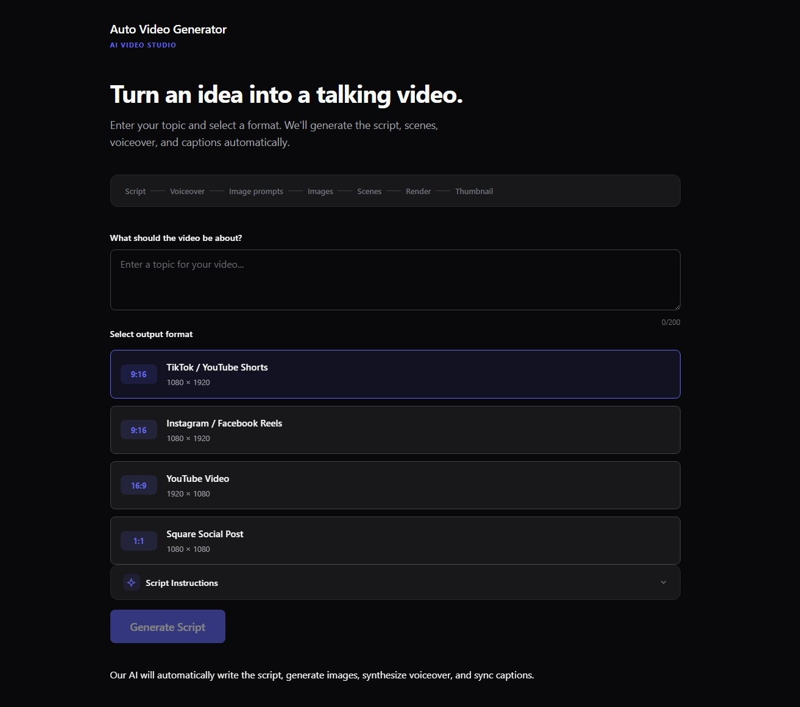
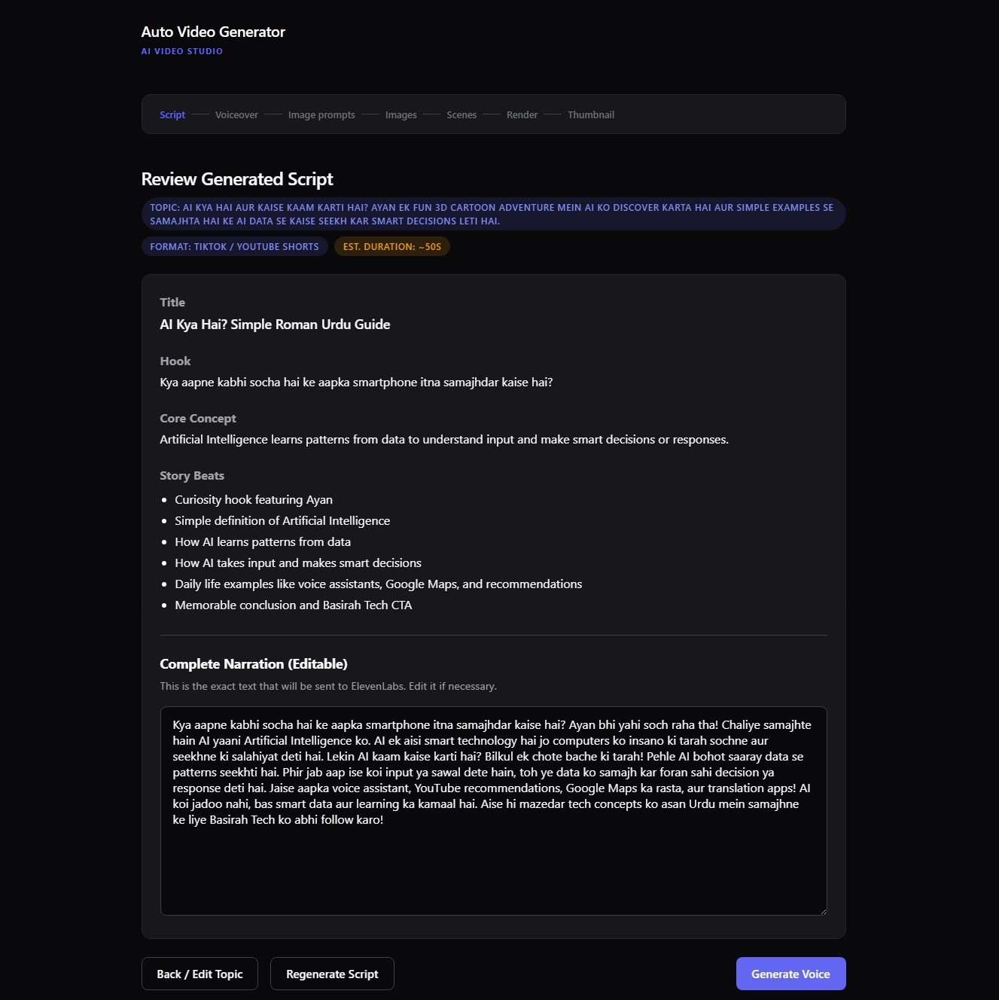
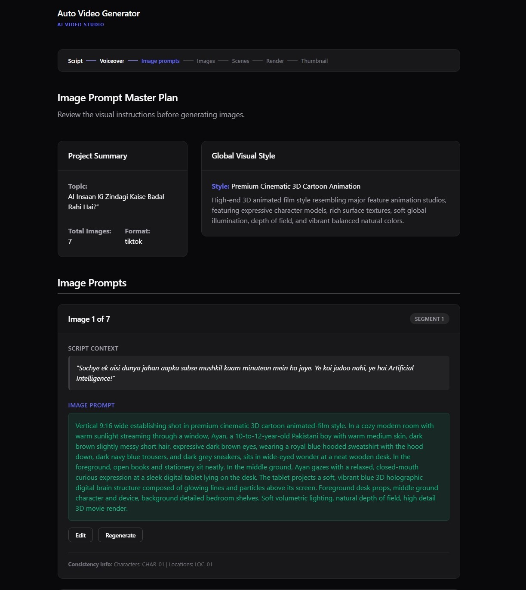
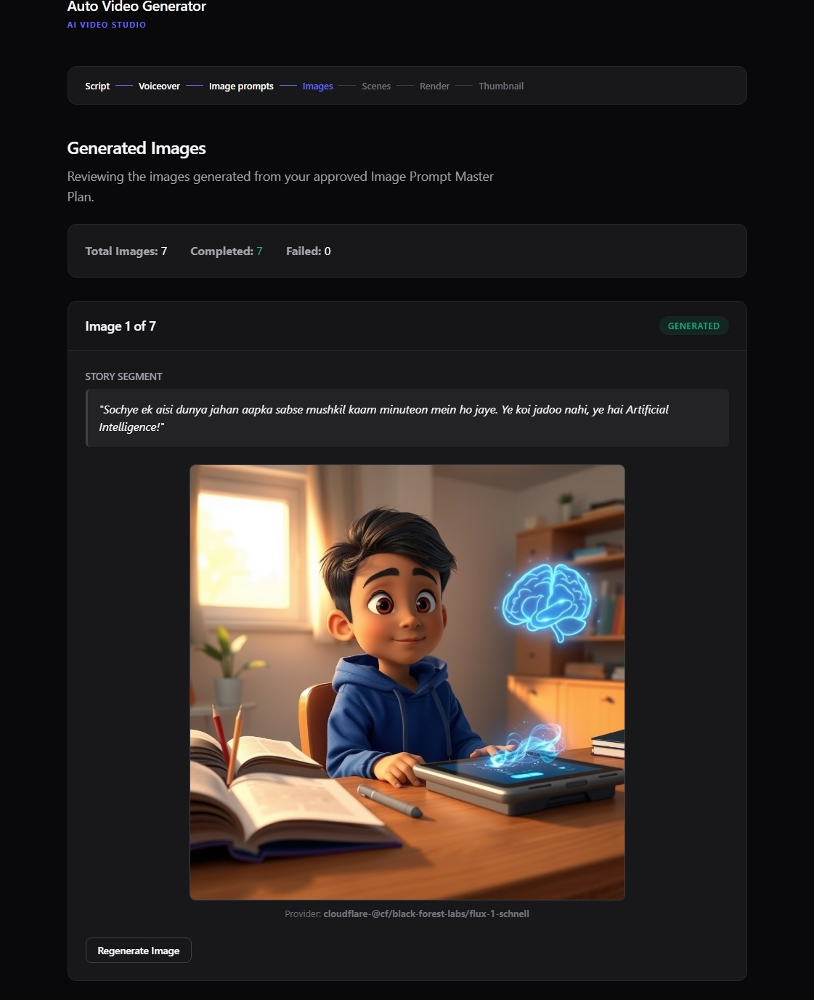
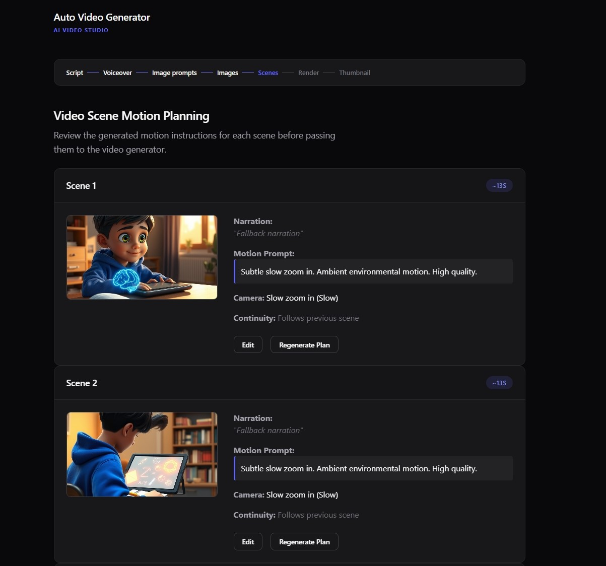
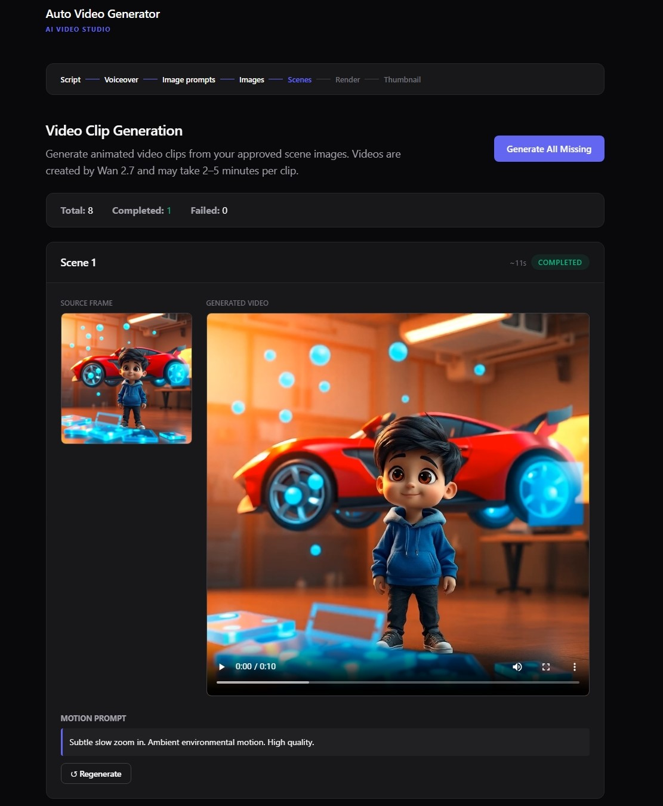
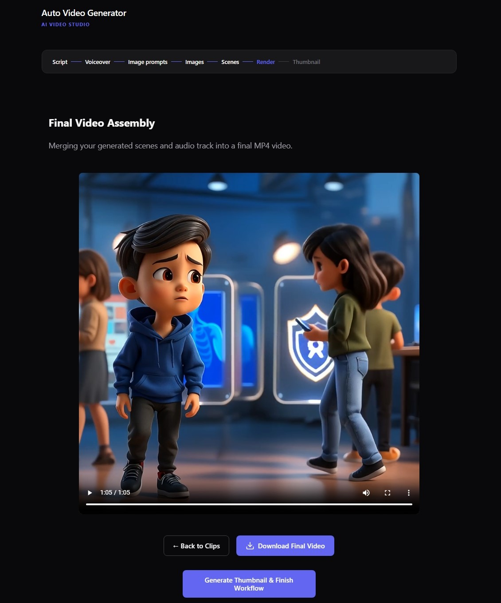
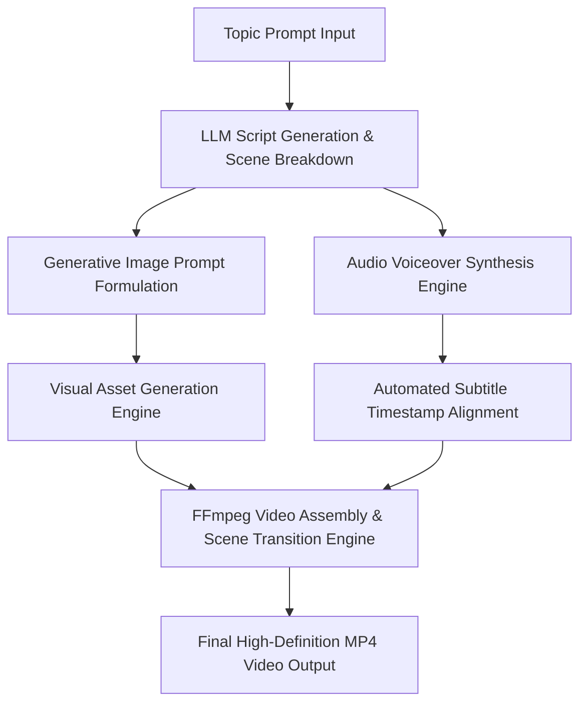

<div align="center">

<h1>Autonomous Video Generation & Media Pipeline</h1>


<p><strong>End-to-End Autonomous Pipeline for Programmatic Media Generation, Voiceover, and Assembly</strong></p>

<p>
  <a href="https://skillicons.dev"></a>
</p>

<p>
  <a href="#overview">Overview</a> &bull;
  <a href="#system-architecture">Architecture</a> &bull;
  <a href="#visual-showcase-gallery">Visual Gallery</a> &bull;
  <a href="#core-capabilities">Capabilities</a> &bull;
  <a href="#installation--setup">Installation</a> &bull;
  <a href="#author--contact-information">Author</a>
</p>

</div>

---
## Overview

The Autonomous Video Generator is a distributed application framework that automates narrative video production. Given a prompt or subject outline, the system constructs sequential video scene prompts, synthesizes relevant visual assets, generates synchronized voiceover audio, produces precise subtitle tracks, and renders the composite media into high-definition video files.

---

## Visual Showcase Gallery

<table width="100%" align="center">
  <tr>
    <td width="50%" align="center"><b>Topic Ingestion & Script Studio</b><br><sub>Prompt parameter configuration and structured script generation.</sub></td>
    <td width="50%" align="center"><b>Scene-by-Scene Visual Breakdown</b><br><sub>Granular scene sequencing with prompt customization.</sub></td>
  </tr>
  <tr>
    <td align="center"></td>
    <td align="center"></td>
  </tr>
  <tr>
    <td width="50%" align="center"><b>Audio Synthesis & Voiceover Selection</b><br><sub>Voice parameter tuning with synchronized timestamp alignment.</sub></td>
    <td width="50%" align="center"><b>Final Media Assembly & Video Preview</b><br><sub>Rendered video output with embedded subtitles and transition timing.</sub></td>
  </tr>
  <tr>
    <td align="center"></td>
    <td align="center"></td>
  </tr>
  <tr>
    <td width="50%" align="center"><b>Generative Image Asset Inspector</b><br><sub>Review and regeneration interface for individual video keyframes.</sub></td>
    <td width="50%" align="center"><b>Subtitle Styling & Font Palette</b><br><sub>Dynamic typographic controls for video caption overlays.</sub></td>
  </tr>
  <tr>
    <td align="center"></td>
    <td align="center"></td>
  </tr>
  <tr>
    <td width="50%" align="center"><b>Multi-Scene Assembly Queue</b><br><sub>Concurrent rendering monitor tracking scene transitions.</sub></td>
    <td width="50%" align="center"><b>Export & Download Hub</b><br><sub>Direct MP4 video file export and metadata JSON packaging.</sub></td>
  </tr>
  <tr>
    <td align="center"></td>
    <td align="center"></td>
  </tr>
</table>

---

## System Architecture



---

## Technology Stack

| Component | Technologies |
| :--- | :--- |
| Frontend | React, TypeScript, Vite, Tailwind CSS |
| Backend Server | Node.js, Express, TypeScript |
| Media Processing | FFmpeg, Audio/Video Assembly Services |
| AI Integration | LLM Providers, Image Synthesis Providers |

---

## Installation & Setup

```bash
# Clone the repository
git clone https://github.com/sohailahmed-bsrh/auto-video-generator.git
cd auto-video-generator

# Setup backend
cd backend
npm install
npm run dev

# Setup frontend
cd ../frontend
npm install
npm run dev
```
---

## Author & Contact Information

<table width="100%" align="center">
  <tr>
    <td align="center" style="padding: 20px;">
      <h3>Sohail Ahmed</h3>
      <p><strong>Full-Stack Artificial Intelligence & Computer Vision Engineer</strong></p>
      <p>
        <a href="https://sohail.devsil.com"></a>
        <a href="https://github.com/sohailahmed-bsrh"></a>
        <a href="https://linkedin.com/in/sohail-ahmed-dev"></a>
        <a href="mailto:sohail.bsrh@gmail.com"></a>
      </p>
      <p><em>Available for technical roles in Artificial Intelligence, Computer Vision, and Full-Stack Engineering.</em></p>
      <hr style="border: 0; height: 1px; background: #30363d; margin: 15px 0;">
      <small>Repository: <code>sohailahmed-bsrh/auto-video-generator</code> &bull; Distributed under the MIT License.</small>
    </td>
  </tr>
</table>
