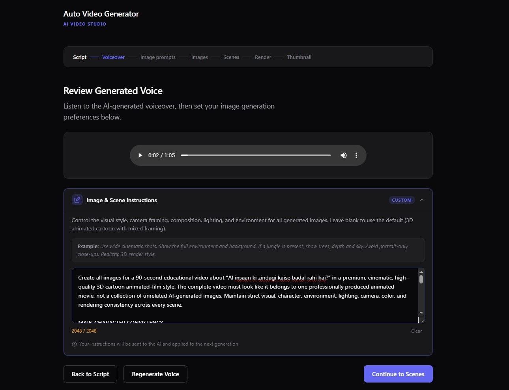
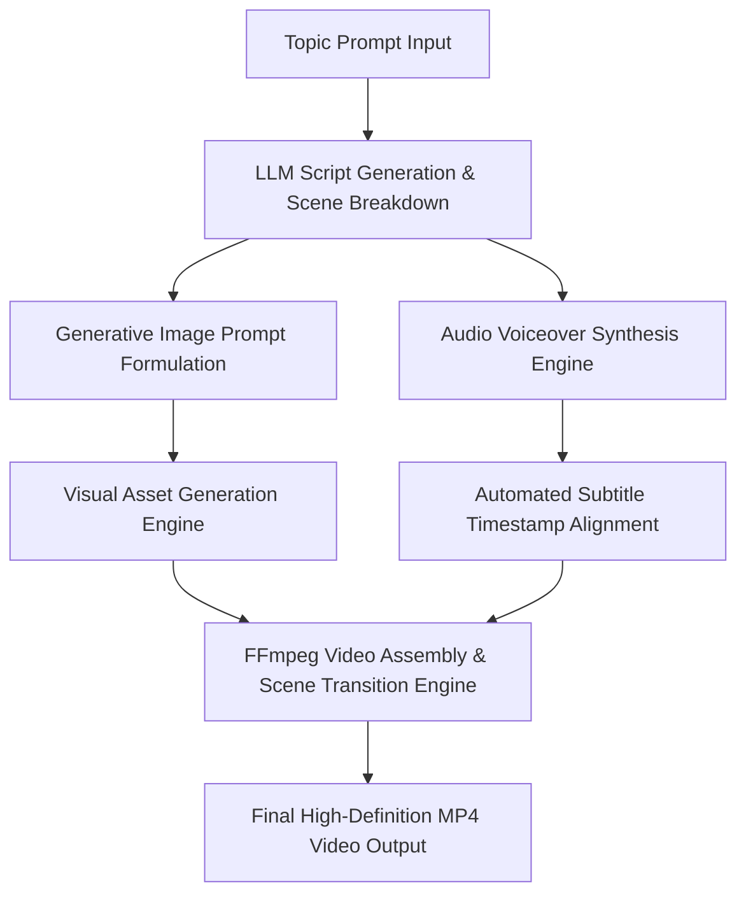

<div align="center">

<h1>Autonomous Video Generation & Media Pipeline</h1>


<p><strong>End-to-End Autonomous Pipeline for Programmatic Media Generation, Voiceover, and Assembly</strong></p>

<p>
  <a href="https://skillicons.dev"></a>
</p>

</div>

---

## Executive Summary

The Autonomous Video Generator is a distributed application framework that automates narrative video production. Given a prompt or subject outline, the system constructs sequential video scene prompts, synthesizes relevant visual assets, generates synchronized voiceover audio, produces precise subtitle tracks, and renders the composite media into high-definition video files.

---

## Application Interface & Synthesis Pipeline Gallery

<table align="center">
  <tr>
    <td align="center"><b>Topic Ingestion & Script Studio</b><br><sub>Prompt parameter configuration and structured script generation.</sub></td>
    <td align="center"><b>Scene-by-Scene Visual Breakdown</b><br><sub>Granular scene sequencing with prompt customization.</sub></td>
  </tr>
  <tr>
    <td align="center"></td>
    <td align="center"></td>
  </tr>
  <tr>
    <td align="center"><b>Audio Synthesis & Voiceover Selection</b><br><sub>Voice parameter tuning with synchronized timestamp alignment.</sub></td>
    <td align="center"><b>Final Media Assembly & Video Preview</b><br><sub>Rendered video output with embedded subtitles and transition timing.</sub></td>
  </tr>
  <tr>
    <td align="center"></td>
    <td align="center"></td>
  </tr>
</table>

---

## System Architecture



---

## Technology Stack

| Component | Technologies |
| :--- | :--- |
| Frontend | React, TypeScript, Vite, Tailwind CSS |
| Backend Server | Node.js, Express, TypeScript |
| Media Processing | FFmpeg, Audio/Video Assembly Services |
| AI Integration | LLM Providers, Image Synthesis Providers |

---

## Installation & Setup

```bash
# Clone the repository
git clone https://github.com/sohailahmed-bsrh/auto-video-generator.git
cd auto-video-generator

# Setup backend
cd backend
npm install
npm run dev

# Setup frontend in another terminal
cd ../frontend
npm install
npm run dev
```

---

## Author & License

- **Author**: Sohail Ahmed ([Portfolio](https://sohail.devsil.com) | [GitHub](https://github.com/sohailahmed-bsrh))
- **License**: Distributed under the MIT License.
