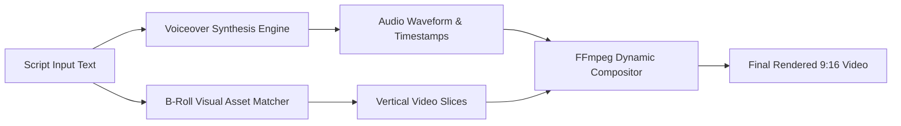

# Automated Short-Form Text-to-Video Engine

> Script-driven automated pipeline assembling vertical short-form videos with synthesized voiceover.

[](https://github.com/sohailahmed-bsrh/auto-video-generator)
[](https://sohail.devsil.com/projects.html)
[](https://sohail.devsil.com)

---

## Overview

Producing high-volume short-form content for modern social media platforms requires manual asset gathering, voiceover recording, and timed text overlays.

This project provides an end-to-end, reproducible implementation engineered to solve this challenge through verified data transformations, reliable algorithms, and production-ready architecture.

---

## Key Features

- Script text breakdown into timed thematic presentation segments
- Text-to-speech voice synthesis integration with ElevenLabs and gTTS
- Automated background b-roll clip retrieval and vertical format cropping (9:16)
- Dynamic text caption animations synchronized with audio waveforms

---

## System Architecture



---

## Technology Stack

| Technology | Version / Spec | Role in Architecture |
| :--- | :--- | :--- |
| **React & TypeScript** | `18.2+` | Web control dashboard with live audio/video player |
| **Node.js & Express** | `18+` | Asset storage, synthesis orchestration, and render queues |
| **FFmpeg** | `5.1+` | High-performance video assembly and caption burn-in |

---

## Repository Structure

```text
auto-video-generator/
|-- auto-video-generator/
|   |-- backend/
|   |   |-- src/
|   |   `-- package.json
|   `-- frontend/
|       |-- src/
|       `-- package.json
|-- .gitignore
`-- README.md
```

---

## Installation and Execution

### Prerequisites
- Python 3.10 or higher
- Git version control
- Virtual environment manager (`venv`)

### Setup Instructions
1. Clone the repository:
```bash
git clone https://github.com/sohailahmed-bsrh/auto-video-generator.git
cd auto-video-generator
```

2. Configure environment and dependencies:
```bash
cd auto-video-generator/backend && npm install
cd ../frontend && npm install
npm run dev
```

---

## Interface and Verification
The system produces verifiable execution logs, prediction matrices, or interactive browser interfaces depending on the target mode. Verify operation by executing the commands specified above or inspecting the demonstration notebooks.

---

## Author and Contact
Developed by **Sohail Ahmed** — Full Stack AI Engineer & Machine Learning Specialist.
- **Portfolio:** [sohail.devsil.com](https://sohail.devsil.com)
- **GitHub:** [@sohailahmed-bsrh](https://github.com/sohailahmed-bsrh)
- **Email:** [sohail.bsrh@gmail.com](mailto:sohail.bsrh@gmail.com)
