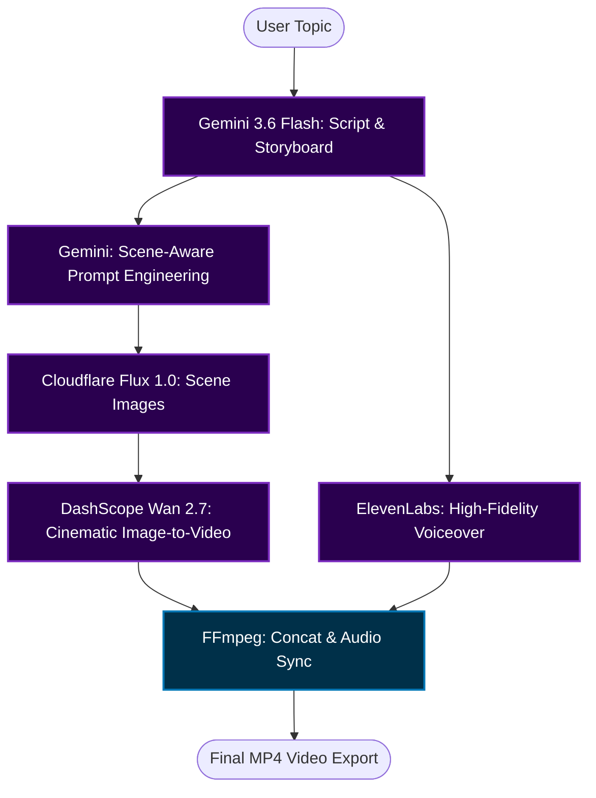
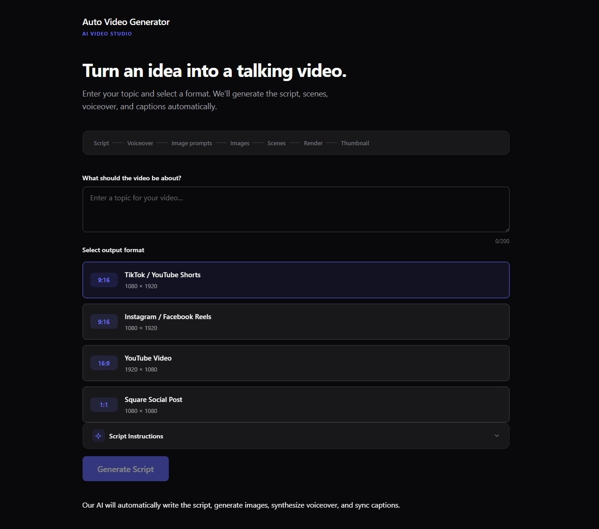
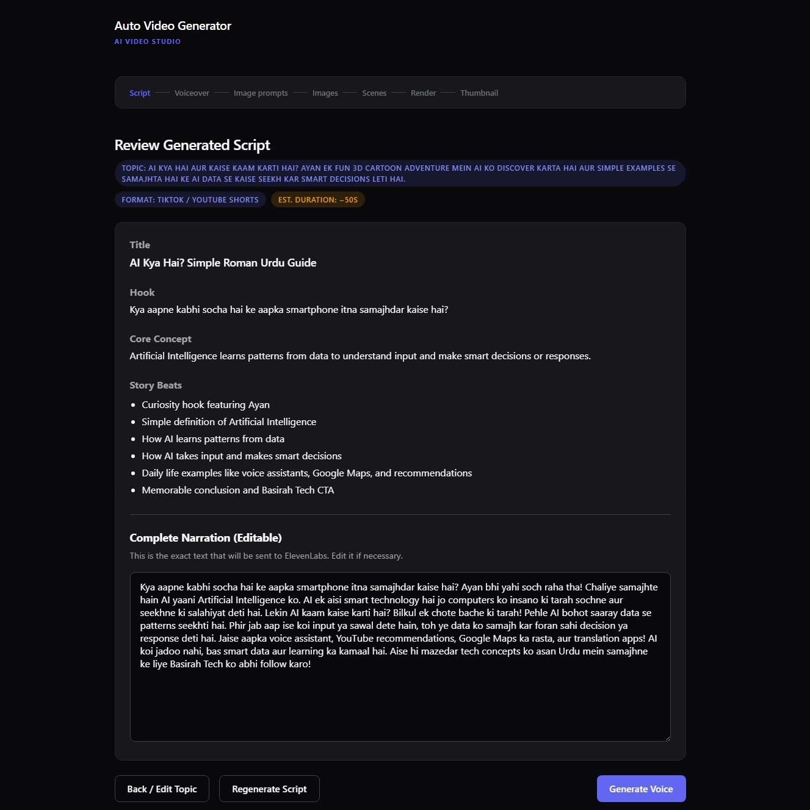
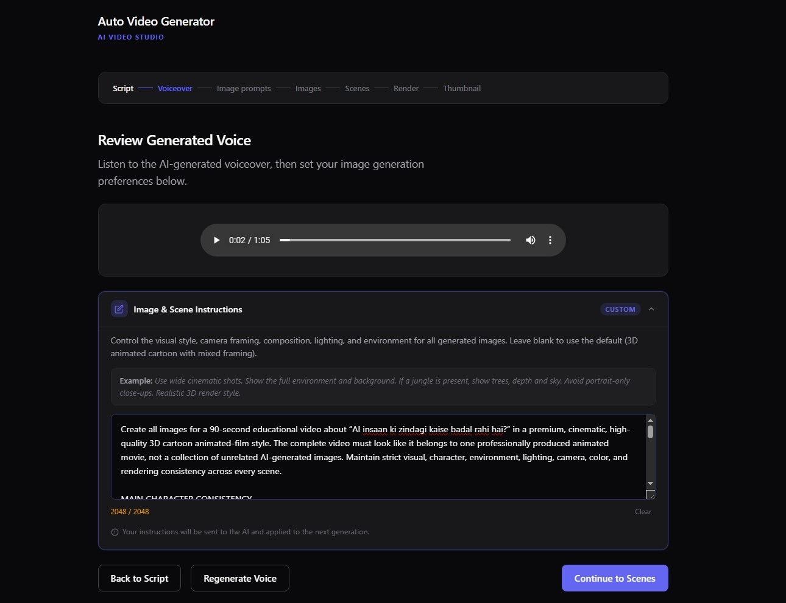
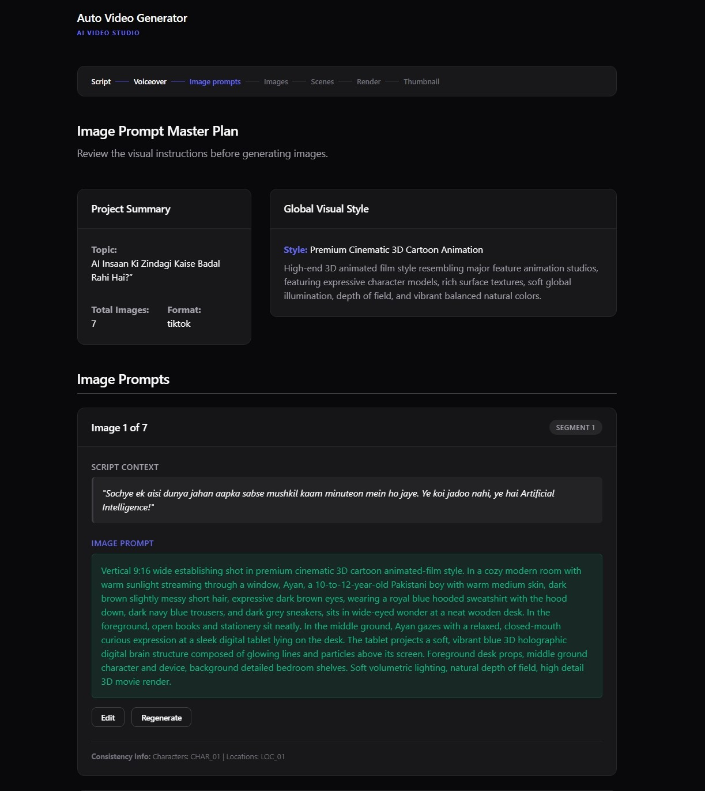
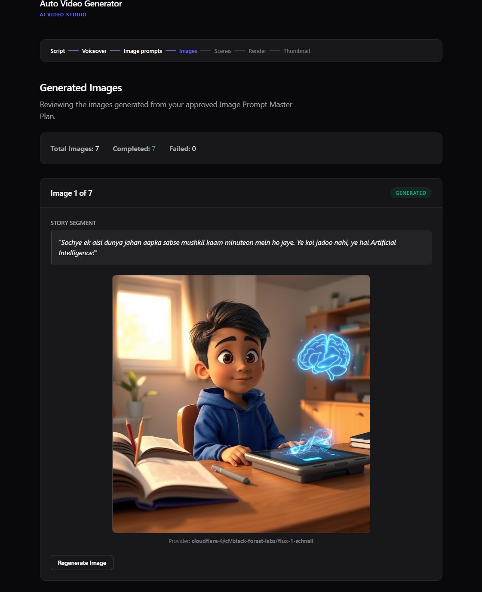
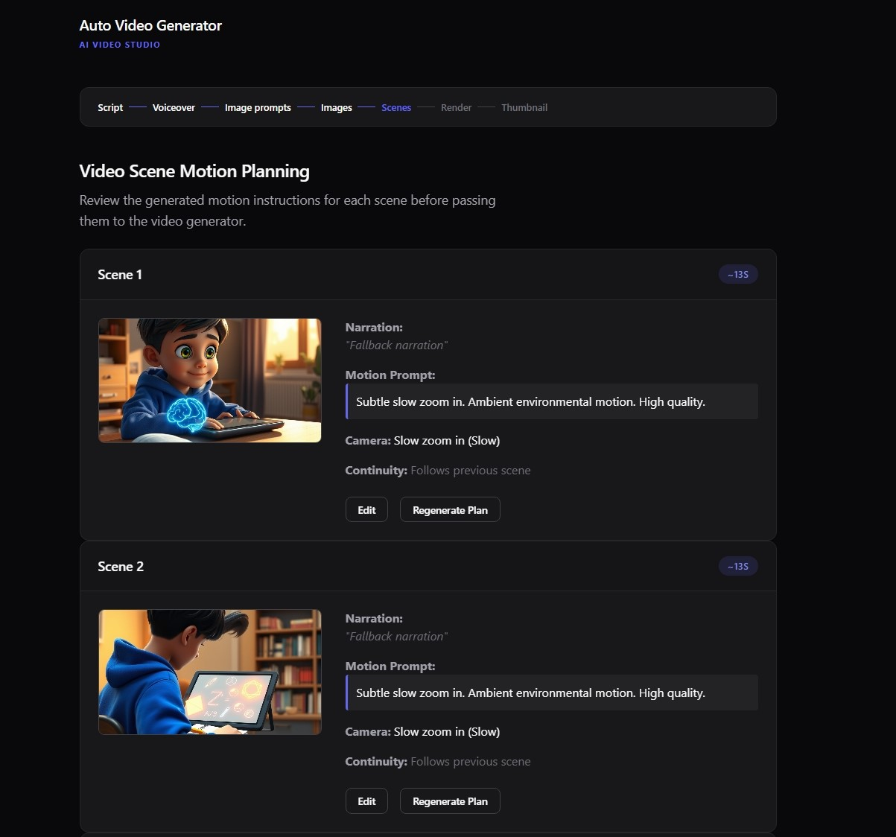
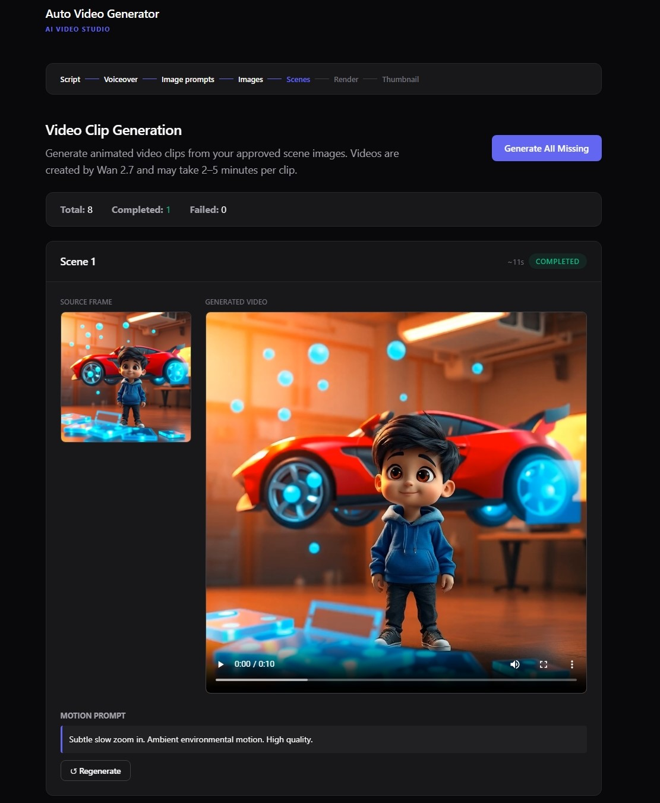
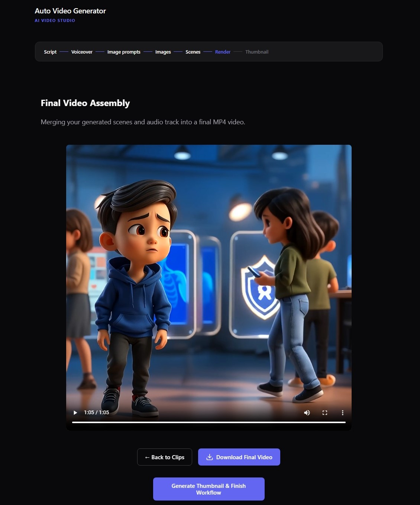

<div align="center">

<!-- Animated Header Wave -->


<br/><br/>

[](#)
[](#)
[](#)
[](#)
[](#)

> **Transform a single text prompt into a cinematic, fully narrated video in minutes.**  
> An enterprise-grade, multi-agent AI pipeline combining LLMs, Text-to-Speech, Image Generation, and Image-to-Video models.

</div>

<br/>

---

## 🏗️ System Architecture

Our robust pipeline is orchestrated through an asynchronous Node.js backend, ensuring fault tolerance, rate-limit handling, and high-quality generation at every node.



<br/>

---

## ✨ Enterprise Features

<table>
  <tr>
    <td width="50%">
      <h3>🧠 Autonomous Intelligence</h3>
      <p>The system independently breaks down topics into a structured master plan, assigning specific environments, character traits, and camera angles to each scene without human intervention.</p>
    </td>
    <td width="50%">
      <h3>🎞️ Cinematic Consistency</h3>
      <p>Through strict prompt engineering and state-machine tracking, the pipeline ensures visual, lighting, and thematic continuity across all generated frames.</p>
    </td>
  </tr>
  <tr>
    <td width="50%">
      <h3>🛡️ Fault-Tolerant Engine</h3>
      <p>Features intelligent circuit breakers, async polling, and deterministic fallback generators to handle quota limits, network timeouts, and model halucinations gracefully.</p>
    </td>
    <td width="50%">
      <h3>⚡ High-Performance Assembly</h3>
      <p>Utilizes hardware-accelerated <code>FFmpeg</code> for frame-perfect concatenation, audio mapping, and multi-stream sync, bypassing heavy re-encoding where possible.</p>
    </td>
  </tr>
</table>

<br/>

---

## 📸 Showcase & Visuals

<div align="center">
  <table style="border: none;">
    <tr>
      <td style="border: none;"></td>
      <td style="border: none;"></td>
    </tr>
    <tr>
      <td style="border: none;"></td>
      <td style="border: none;"></td>
    </tr>
    <tr>
      <td style="border: none;"></td>
      <td style="border: none;"></td>
    </tr>
    <tr>
      <td style="border: none;"></td>
      <td style="border: none;"></td>
    </tr>
  </table>
</div>

<br/>

---

## Deployment & Installation

```bash
# 1. Clone the repository
git clone https://github.com/sohail-ahmed-26/auto-video-generator.git

# 2. Install Backend Dependencies
cd auto-video-generator/backend
npm install

# 3. Setup Environment Variables (.env)
GEMINI_API_KEY=your_gemini_key
ELEVENLABS_API_KEY=your_elevenlabs_key
CLOUDFLARE_API_TOKEN=your_cloudflare_token
WAN_API_KEY=your_dashscope_wan_key
VIDEO_PROVIDER=WAN

# 4. Boot the Microservices
npm run dev

# 5. Boot the Frontend Interface
cd ../frontend
npm install
npm run dev
```

<br/><br/><br/>

<div align="center">

## 👨‍💻 Meet The Architect

<!-- Animated Typing Info for Author -->
<a href="https://sohail.devsil.com">
  
</a>

<br/><br/>

<a href="https://sohail.devsil.com">
  
</a>

<br/><br/>

### **Sohail Ahmed**
*Transforming raw data into automated business intelligence.*

<br/>

**🔗 Let's Connect:**

[](https://sohail.devsil.com)
[](https://github.com/sohail-ahmed-26)
[](https://www.linkedin.com/in/sohail-ahmed-devsil)
[](https://www.kaggle.com/sohail2411126)

<br/>

© 2026 Sohail Ahmed · All rights reserved.

<!-- Animated Footer Wave -->


</div>
